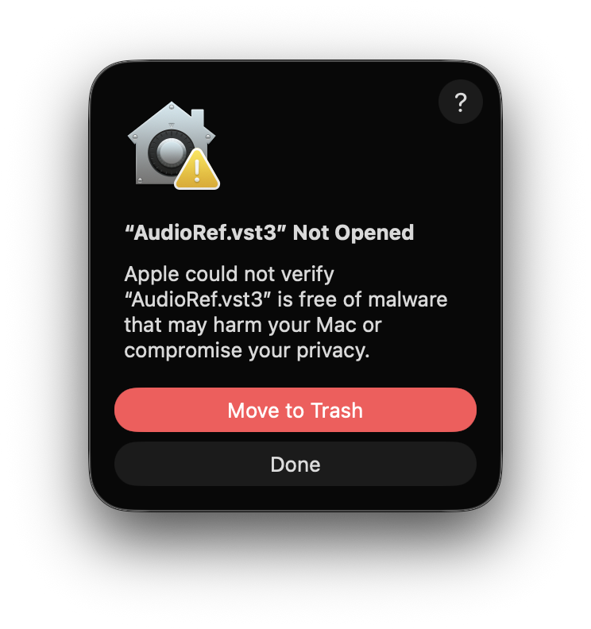

# AudioRef

[](https://github.com/FionaPreroll/audioref/actions/workflows/release.yml)
[](https://codecov.io/gh/FionaPreroll/audioref)

AudioRef is a VST3 and CLAP plugin that evens out the frequency response of your headphones, so that budget and consumer headphones, e.g. Bose QC25, Sony WH-1000XM4 or AKG K240 Studio, sound closer to neutral studio monitoring while you mix and master.

> **Early development.** AudioRef corrects headphones with OPRA's EQ presets so far: built in for the Bose QC25, the Sony WH-1000XM4 and the AKG K240 Studio, for all others from OPRA's database. Own target curves, AutoEQ's measurements and crossfeed follow, see [docs/PLAN.md](docs/PLAN.md#next-steps).

## Disclaimer

**AudioRef is for private, non-commercial use only**, and comes without any warranty.

AudioRef has OPRA's EQ presets for the Bose QC25, the Sony WH-1000XM4 and the AKG K240 Studio built in, by oratory1990 and AutoEQ, see [data/opra](data/opra/README.md); they are licensed under CC BY-SA 4.0, not under AudioRef's license. Everything else it reads from files you download yourself, e.g. from [AutoEQ](https://github.com/jaakkopasanen/AutoEq) (measurements by oratory1990) or [OPRA](https://github.com/opra-project/OPRA). These data belong to their authors and have their own terms: oratory1990 prohibits unlicensed commercial use of his measurements, and OPRA's data is licensed under CC BY-SA 4.0. Don't use AudioRef or such data commercially without their authors' permission.

Headphone correction belongs in the monitoring path only: bypass AudioRef before you export a mix or master.

## Installing

Download the archive for your system from the [latest release](https://github.com/FionaPreroll/audioref/releases/latest), or from the pre-release [`snapshot`](https://github.com/FionaPreroll/audioref/releases/tag/snapshot), which always has the latest build of `main`:

| System | Archive | Copy `AudioRef.vst3` to | Copy `AudioRef.clap` to |
|---|---|---|---|
| Windows 10 or newer (x86_64) | `audioref-windows-x86_64.zip` | `C:\Program Files\Common Files\VST3` | `C:\Program Files\Common Files\CLAP` |
| macOS (Intel and Apple silicon) | `audioref-macos-universal.zip` | `~/Library/Audio/Plug-Ins/VST3` | `~/Library/Audio/Plug-Ins/CLAP` |
| Linux (x86_64) | `audioref-linux-x86_64.zip` | `~/.vst3` | `~/.clap` |

Then let your DAW rescan its plugins. In Bitwig, use the CLAP version.

On macOS, the bundles are signed ad hoc but not notarized, so macOS may refuse to load them:



Click **Done**, not **Move to Trash**, and allow them once with:

```sh
xattr -dr com.apple.quarantine ~/Library/Audio/Plug-Ins/VST3/AudioRef.vst3 ~/Library/Audio/Plug-Ins/CLAP/AudioRef.clap
```

Then let your DAW rescan its plugins again.

## Using AudioRef

1. Open AudioRef's window. It lists the headphones with built-in presets: the Bose QC25, the Sony WH-1000XM4 and the AKG K240 Studio. If yours are among them, go on with step 3.
2. For other headphones, download OPRA's database, the file [`dist/database_v1.jsonl`](https://github.com/opra-project/OPRA/tree/main/dist) from OPRA's repository (about 12 MB), and keep it anywhere. Paste the file's path into the field at the top, and click **Load**. AudioRef remembers the path and loads the file again the next time; **Load** with an empty field goes back to the built-in presets.
3. Search for your headphones, e.g. "WH-1000XM4". Some come in several modes, e.g. "(ANC on)" and "(ANC off)": pick the one you listen in.
4. Click a preset. Presets by oratory1990, or "Measured by oratory1990", are a good start. The curve shows what the correction does. If the preset boosts some frequencies, AudioRef lowers its level by as much, so nothing gets louder and nothing clips.

The project saves the chosen preset, so it opens with the same correction even on a computer without the file. **Off** turns the correction off. Changing the preset fades over 20 ms.

Put AudioRef last on your master track, after everything else. The correction is for your headphones, not for your mix: AudioRef bypasses itself when your DAW exports offline, but not when it exports in real time, so bypass it yourself then.

| Parameter | Range | What it does |
|---|---|---|
| Output | −24 to +6 dB | The output level |
| Bypass | on, off | Passes the signal through unchanged |
| Bypass on export | on (default), off | Bypasses AudioRef while your DAW exports offline. Not automatable. |

Changes of the output level and the bypass fade over 20 ms, so they don't click. The window and the parameter names follow the language of your operating system: German on German systems, English on all others.

## Documentation

- [docs/PLAN.md](docs/PLAN.md): what was decided in planning, and the next steps
- [docs/ARCHITECTURE.md](docs/ARCHITECTURE.md): how the plugin works inside
- [docs/DEVELOPMENT.md](docs/DEVELOPMENT.md): building, testing, CI and releasing, and how to contribute
- [CHANGELOG.md](CHANGELOG.md): what changed in each version

## License

AudioRef is licensed under the [GNU General Public License v3.0 only](LICENSE). Its VST3 support uses nih-plug's VST3 bindings, which are licensed under the GPLv3 as well. The built-in EQ presets are an excerpt of [OPRA](https://github.com/opra-project/OPRA)'s database, by oratory1990 and AutoEQ, licensed under [CC BY-SA 4.0](https://creativecommons.org/licenses/by-sa/4.0/), see [data/opra](data/opra/README.md), which the archives hold as `OPRA-PRESETS.md`. The window uses the fonts that come with egui: Ubuntu Light under the [Ubuntu Font Licence 1.0](https://ubuntu.com/legal/font-licence), and Noto Emoji and emoji-icon-font under the [SIL Open Font License 1.1](https://openfontlicense.org).
