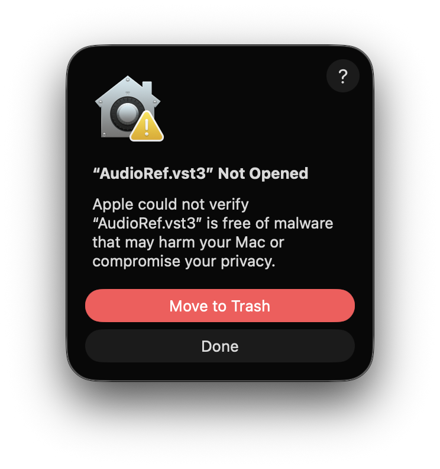
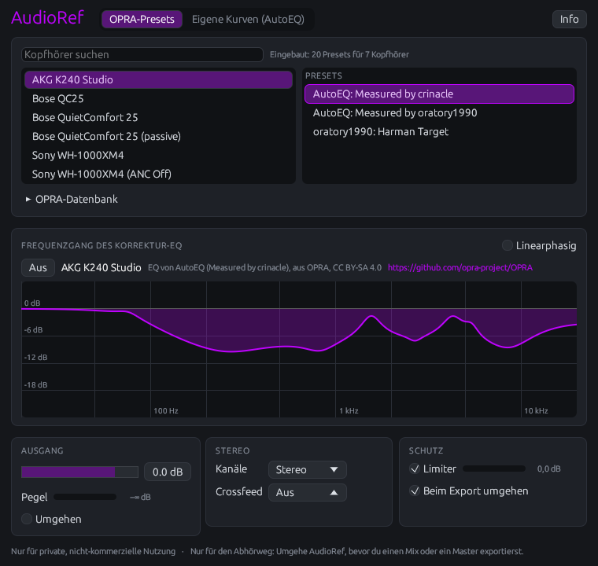
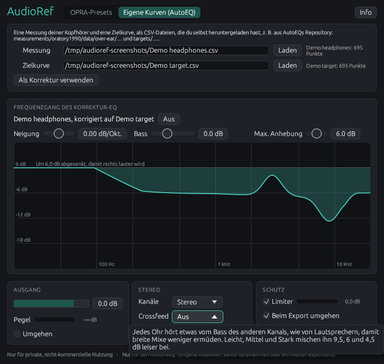
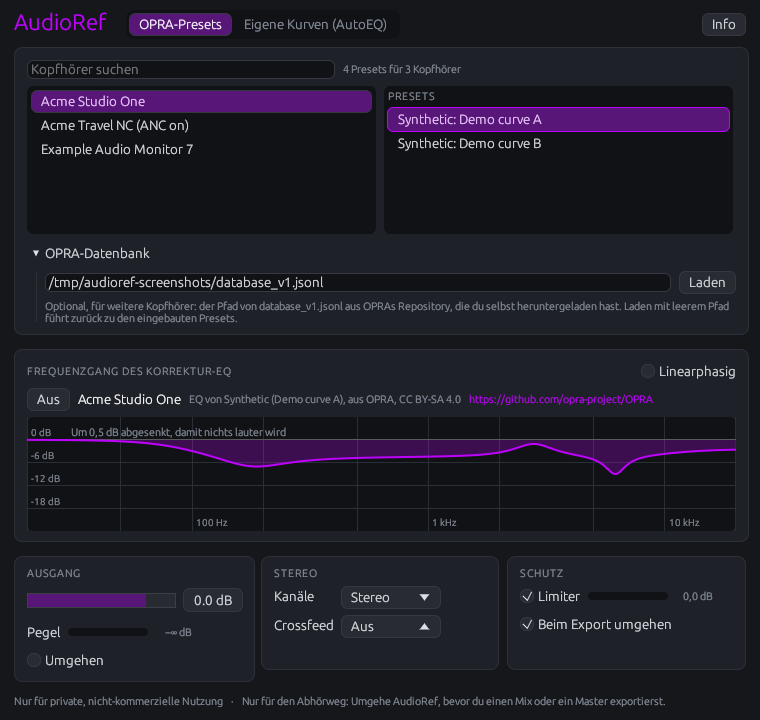
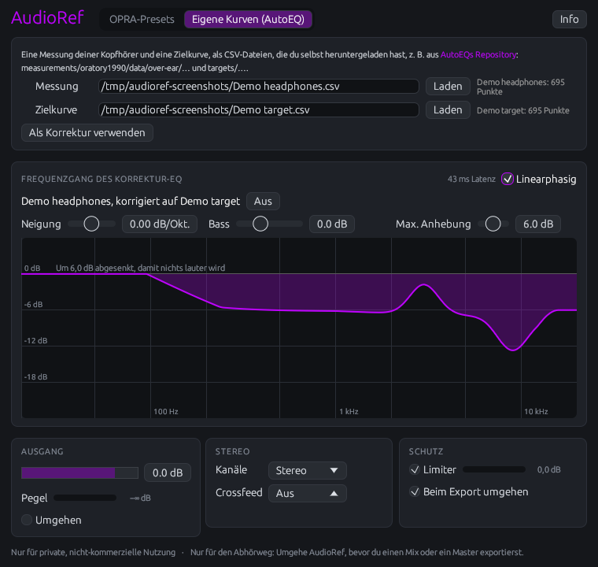

# AudioRef Benutzerhandbuch

## Einführung

### Was AudioRef tut

Jeder Kopfhörer färbt den Klang: Consumer-Kopfhörer heben oft den Bass und einen Teil der Höhen an, Studiokopfhörer haben ihre eigenen Spitzen und Senken. Wer auf ihnen mischt, gleicht ihre Färbung unbemerkt aus, und der Mix klingt anderswo falsch. AudioRef korrigiert den Frequenzgang deiner Kopfhörer auf eine neutrale Zielkurve, damit sie Studiomonitoren in einem akustisch behandelten Raum näherkommen.

Dafür nutzt es einen EQ, der für dein Kopfhörermodell gemacht ist:

- **EQ-Presets aus OPRA**, der offenen Datenbank für Kopfhörer-EQs. Presets für den Bose QC25, den Sony WH-1000XM4 und den AKG K240 Studio sind eingebaut, diese Kopfhörer funktionieren also ohne Download. Für alle anderen lädst du OPRAs Datenbank, die du selbst herunterlädst.
- **Eigene Messung und Zielkurve**, als CSV-Dateien, z. B. aus AutoEQs Repository: AudioRef berechnet daraus die Korrektur, und du passt sie an deinen Geschmack an.

Rund um die Korrektur hat AudioRef, was das Abhören auf Kopfhörern braucht: automatischen Headroom, damit die Korrektur nie etwas lauter macht, einen wahlweise linearphasigen Modus, Mono und vertauschte Kanäle, einen Crossfeed in drei Stärken, einen Ausgangspegel mit Anzeige und einen Limiter, der den Ausgang vor dem Übersteuern bewahrt. Exportiert deine DAW einen Mix offline, umgeht AudioRef sich selbst, damit die Korrektur deiner Kopfhörer nicht im Mix landet.

### Was AudioRef nicht tut

AudioRef korrigiert den durchschnittlichen Frequenzgang eines Kopfhörermodells, wie er auf einem Messkopf gemessen wurde. Es misst weder dein eigenes Exemplar noch deine Ohren, und es simuliert keine Lautsprecher in einem Raum. Dein Kopfhörer, seine Polster und wie er auf deinem Kopf sitzt, weichen immer noch etwas von der Messung ab, vor allem über 5 kHz. Ein korrigierter Kopfhörer ist eine bessere Referenz, ersetzt aber nicht, einen Mix auf anderen Anlagen zu prüfen.

### Was du brauchst

| | |
|--|--------|
| Systeme | Windows 10 oder neuer (x86_64), macOS (Intel und Apple Silicon), Linux (x86_64) |
| Plugin-Formate | VST3 und CLAP |
| DAWs | Jede, die VST3 oder CLAP lädt; getestet in Bitwig Studio 6 (CLAP und VST3) und FL Studio unter Windows |
| Abtastraten | 44,1 bis 192 kHz |
| Kanäle | Stereo rein, Stereo raus |
| Latenz | Keine, oder 43 bis 46 ms linearphasig |

### Nutzungsbedingungen

> [!IMPORTANT]
> **AudioRef ist nur für die private, nicht-kommerzielle Nutzung**, und ohne jede Gewährleistung.
>
> Die eingebauten Presets stammen aus OPRA, von oratory1990 und AutoEQ, unter CC BY-SA 4.0. Alles andere liest AudioRef aus Dateien, die du selbst herunterlädst, von AutoEQ oder OPRA. Diese Daten gehören ihren Urhebern und haben eigene Bedingungen: oratory1990 untersagt die unlizenzierte kommerzielle Nutzung seiner Messungen. Nutze AudioRef oder solche Daten nicht kommerziell ohne die Erlaubnis ihrer Urheber.

### Über dieses Handbuch

Dieses Handbuch beschreibt alles, was du im Fenster des Plugins und in deiner DAW tun kannst, für die Version auf seiner Titelseite. Es ist in Markdown geschrieben, in [`docs/manual`](https://github.com/FionaPreroll/audioref/tree/main/docs/manual), auf Deutsch und auf Englisch, und liegt jedem Download von AudioRef als PDF bei. Die [README](https://github.com/FionaPreroll/audioref#readme), auf Englisch, enthält eine Kurzfassung.

## Installation

### Herunterladen

Lade das Archiv für dein System vom [neuesten Release](https://github.com/FionaPreroll/audioref/releases/latest) auf GitHub herunter, oder vom Vorab-Release [`snapshot`](https://github.com/FionaPreroll/audioref/releases/tag/snapshot), das immer den neuesten Build enthält:

| System | Archiv |
|---|---|
| Windows 10 oder neuer, x86_64 | `audioref-windows-x86_64.zip` |
| macOS, Intel und Apple Silicon | `audioref-macos-universal.zip` |
| Linux, x86_64 | `audioref-linux-x86_64.zip` |

Jedes Archiv enthält das Plugin als `AudioRef.vst3` und `AudioRef.clap`, dieses Handbuch auf Deutsch und Englisch (`audioref-manual-de.pdf`, `audioref-manual-en.pdf`), die README, das Changelog, die Lizenz sowie Quelle und Lizenz der eingebauten Presets (`OPRA-PRESETS.md`). Das Release bietet die Handbücher auch einzeln zum Download an.

Um einen Download zu prüfen, vergleiche seine Prüfsumme mit der Datei `SHA256SUMS` des Releases, und prüfe mit der [GitHub CLI](https://cli.github.com), dass AudioRefs eigener Workflow ihn gebaut hat:

```sh
sha256sum --check --ignore-missing SHA256SUMS
gh attestation verify audioref-windows-x86_64.zip --repo FionaPreroll/audioref
```

### Die Plugins kopieren

Entpacke das Archiv und kopiere die Bundles in die Ordner, in denen deine DAW nach Plugins sucht:

| System | `AudioRef.vst3` nach | `AudioRef.clap` nach |
|---|---|---|
| Windows | `C:\Program Files\Common Files\VST3` | `C:\Program Files\Common Files\CLAP` |
| macOS | `~/Library/Audio/Plug-Ins/VST3` | `~/Library/Audio/Plug-Ins/CLAP` |
| Linux | `~/.vst3` | `~/.clap` |

Du brauchst nur eines der beiden Formate, das, welches deine DAW bevorzugt; beide zu kopieren schadet nicht. Lass deine DAW dann ihre Plugins neu einlesen. In Bitwig nimm die CLAP-Version.

### macOS: die Plugins erlauben

Unter macOS sind die Bundles ad hoc signiert, aber nicht von Apple notarisiert, daher verweigert macOS beim ersten Mal womöglich, sie zu laden:



Klicke **Fertig**, nicht **In den Papierkorb legen**, und erlaube beide Bundles einmal im Terminal:

```sh
xattr -dr com.apple.quarantine \
    ~/Library/Audio/Plug-Ins/VST3/AudioRef.vst3 \
    ~/Library/Audio/Plug-Ins/CLAP/AudioRef.clap
```

Lass deine DAW dann ihre Plugins noch einmal neu einlesen.

### Aktualisieren und entfernen

Um AudioRef zu aktualisieren, ersetze die Bundles bei geschlossener DAW durch die der neuen Version. Projekte behalten ihre Einstellungen: Sie öffnen sich in der neuen Version mit derselben Korrektur.

Um AudioRef zu entfernen, lösche `AudioRef.vst3` und `AudioRef.clap` aus den Ordnern oben. AudioRef schreibt keine weiteren Dateien: Alles, was es sich merkt, steht in deinen Projekten.

## Schnellstart

1. Setze AudioRef auf deine Master-Spur, als letztes Plugin, nach allem anderen.
2. Öffne das Fenster von AudioRef. Es listet die Kopfhörer mit eingebauten Presets.
3. Klicke deine Kopfhörer an, z. B. „Sony WH-1000XM4“. Gibt es sie in mehreren Modi, z. B. „(ANC on)“ und „(ANC Off)“, wähle den, mit dem du hörst.
4. Klicke rechts ein Preset an. Presets von oratory1990 oder „Measured by oratory1990“ sind ein guter Anfang.
5. Hör hin. **Umgehen** schaltet die Korrektur aus und an, zum Vergleichen.
6. Bevor du einen Mix exportierst, musst du in den meisten DAWs nichts tun: AudioRef umgeht sich selbst, während die DAW offline exportiert. Exportiert deine DAW in Echtzeit, umgehe AudioRef selbst, siehe [Exportieren](#exportieren).



Das Projekt speichert das gewählte Preset und öffnet sich deshalb mit derselben Korrektur, auch auf einem Rechner ganz ohne Dateien. Sind deine Kopfhörer nicht eingebaut, siehe [Weitere Kopfhörer aus OPRAs Datenbank](#weitere-kopfhörer-aus-opras-datenbank).

## Das Fenster

Das Fenster von AudioRef hat immer dieselben Teile, von oben nach unten:

| Teil | Was darin steht |
|----|----------------|
| Kopfzeile | Der Name AudioRef, die Tabs **OPRA-Presets** und **Eigene Kurven (AutoEQ)**, die wählen, woher die Korrektur kommt, und **Info** |
| Quelle | Bei **OPRA-Presets**: die Suche, die Liste der Kopfhörer, ihre Presets und der einklappbare Bereich **OPRA-Datenbank**. Bei **Eigene Kurven (AutoEQ)**: die Dateien einer Messung und einer Zielkurve, und **Als Korrektur verwenden** |
| Korrektur | **Frequenzgang des Korrektur-EQ**: der Schalter **Linearphasig**, der Name der aktuellen Korrektur mit ihrem Urheber, **Aus**, bei eigenen Kurven die Regler **Neigung**, **Bass** und **Max. Anhebung**, und die Kurve |
| Ausgang | Der Ausgangspegel, die Anzeige **Pegel** und **Umgehen** |
| Stereo | **Kanäle** und **Crossfeed** |
| Schutz | **Limiter** mit seiner Anzeige, und **Beim Export umgehen** |
| Hinweise | „Nur für private, nicht-kommerzielle Nutzung“, und dass AudioRef nur in den Abhörweg gehört |

Die Kurve zeigt die Korrektur von 20 Hz bis 20 kHz, mit einer Linie alle 6 dB. Lass den Zeiger auf ihr ruhen, um den Pegel bei einer Frequenz abzulesen, z. B. „1,2 kHz −4,3 dB“. Über der Linie von 0 dB steht, um wie viel AudioRef die Korrektur abgesenkt hat, siehe [Headroom](#headroom).

### Hinweise im Fenster

Lass den Zeiger auf einem Bedienelement ruhen, um zu sehen, was es tut. Wo das Fenster auf etwas wartet, sagt es, was als Nächstes zu tun ist: Kopfhörer wählen, beide Kurven laden, bevor du sie verwendest, oder den Ausgang senken, wenn der Limiter viel zu tun hat.



### Sprache

Das Fenster und die Namen der Parameter folgen der Sprache deines Betriebssystems: Deutsch auf deutschen Systemen, Englisch auf allen anderen. Ein Projekt, das in einer Sprache gespeichert wurde, öffnet sich in der anderen mit denselben Einstellungen, denn DAWs speichern Parameter nach ihren IDs, nicht nach ihren Namen.

### Info

**Info** oben rechts, oder ein Klick auf den Namen AudioRef, öffnet das Fenster „Über AudioRef“: die Version und den Build von AudioRef, den Kontakt, die Website, die Lizenzen von AudioRef und seiner eingebauten Presets, und jede Software, mit der AudioRef gebaut ist, mit ihrem Lizenztext.

## Korrektur mit OPRAs Presets

[OPRA](https://github.com/opra-project/OPRA) ist eine offene, von der Community gepflegte Datenbank mit EQ-Presets für Kopfhörer. oratory1990 veröffentlicht seine Presets dort selbst, und AutoEQ ergänzt Presets, die aus den Messungen mehrerer Tester berechnet sind. Ein Preset ist ein parametrischer EQ: eine Liste von Filtern, z. B. Glocken und Kuhschwanzfilter, mit Frequenz, Verstärkung und Güte, und eine Gesamtverstärkung. AudioRef setzt es mit Filtern um, die dem Preset bis in die höchsten Frequenzen genau folgen, bei jeder Abtastrate.

### Eingebaute Kopfhörer

Ohne Datei enthält die Liste die Kopfhörer, deren Presets in AudioRef eingebaut sind, aus OPRAs Datenbank vom 8. November 2026:

| Kopfhörer | In der Liste |
|---|---|
| AKG K240 Studio | K240 Studio |
| Bose QC25 | QC25, QuietComfort 25, QuietComfort 25 (passive) |
| Sony WH-1000XM4 | WH-1000XM4, WH-1000XM4 (ANC on), WH-1000XM4 (ANC Off) |

Neben der Suche steht, wie viele Presets die Liste enthält, z. B. „Eingebaut: 20 Presets für 7 Kopfhörer“. OPRA führt manche Modi eines Modells als eigene Kopfhörer, z. B. mit aktiver Geräuschunterdrückung an oder aus, und manche Modelle unter mehreren Namen, z. B. QC25 und QuietComfort 25: Ihre Presets stammen von verschiedenen Urhebern.

### Weitere Kopfhörer aus OPRAs Datenbank

Für andere Kopfhörer lädst du OPRAs ganze Datenbank herunter und lässt AudioRef sie lesen:

1. Lade die Datei [`dist/database_v1.jsonl`](https://github.com/opra-project/OPRA/tree/main/dist) aus OPRAs Repository herunter, etwa 12 MB, und leg sie irgendwo ab, z. B. in deinen Dokumenten.
2. Öffne im Fenster von AudioRef **OPRA-Datenbank** unter den Listen.
3. Füge den Pfad der Datei in das Feld ein, z. B. `C:\Users\du\Documents\database_v1.jsonl` oder `/Users/du/Documents/database_v1.jsonl`, und klicke **Laden**.

AudioRef liest die Datei im Hintergrund, in etwa einer Zehntelsekunde, und sagt dann, wie viele Presets es gefunden hat, als „… Presets für … Kopfhörer“. Es merkt sich den Pfad im Projekt und lädt die Datei beim nächsten Öffnen wieder. **Laden** mit leerem Feld führt zurück zu den eingebauten Presets.



Kann AudioRef die Datei nicht verwenden, sagt es, warum, und behält die Presets, die es hatte: „Diese Datei ist nicht OPRAs Datenbank.“ oder „Die Datei ließ sich nicht lesen:“ mit dem Grund deines Systems, z. B. dass es die Datei nicht gibt. Ein neueres OPRA kann Zeilen ergänzen, die AudioRef noch nicht versteht; es lässt sie aus, sagt, wie viele, z. B. „3 Zeilen ausgelassen, die AudioRef nicht versteht“, und verwendet alle anderen.

> [!TIP]
> Baust du AudioRef aus dem Quellcode, lädt `cargo xtask fetch-profiles` die Datenbank für dich herunter, siehe [Die Dateien holen](#die-dateien-holen).

### Deine Kopfhörer finden

Tippe einen Teil des Namens in **Kopfhörer suchen**, z. B. „WH-1000XM4“ oder „HD 6“. Die Suche findet die Kopfhörer, deren Name, mit dem des Herstellers, jedes getippte Wort enthält, gleich ob groß oder klein, z. B. „sony 1000xm4“, und listet die ersten 200 nach Namen. Kopfhörer mit mehreren Modi stehen für jeden einmal da, z. B. „(ANC on)“, „(ANC off)“ oder „(passive)“: Wähle den, mit dem du hörst. Passt nichts, steht in der Liste „Keine Kopfhörer passen.“

### Ein Preset wählen

Klicke deine Kopfhörer an, dann rechts ein Preset: Es wird sofort zur Korrektur, über 20 ms überblendet, damit es nicht klickt. Die meisten Kopfhörer haben mehrere Presets:

- **oratory1990**, z. B. „oratory1990: Harman Target“: von oratory1990 aus seinen eigenen Messungen gemacht, auf die Harman-Zielkurve. Eine gute erste Wahl.
- **AutoEQ**, z. B. „AutoEQ: Measured by oratory1990“: von AutoEQ aus der genannten Messung berechnet, auf seine Zielkurve. oratory1990 misst auf der Art Messkopf, auf der die Harman-Zielkurve festgelegt wurde.
- Weitere, von anderen Urhebern, wie genannt.

Probiere zwei oder drei aus und behalte das, das für dich am natürlichsten klingt, z. B. mit einem gut bekannten Referenztitel. Unter der Überschrift der Kurve zeigt das Fenster die Kopfhörer und wer das Preset gemacht hat, z. B. „EQ von AutoEQ (Measured by crinacle), aus OPRA, CC BY-SA 4.0“, mit einem Link zu OPRAs Repository, wie OPRAs Lizenz es verlangt.

### Headroom

Ein EQ, der Kopfhörer korrigiert, hebt manche Frequenzen an, z. B. eine Senke in den Höhen. Das würde das Signal lauter machen und könnte übersteuern. Deshalb senkt AudioRef die ganze Korrektur um ihre größte Anhebung zwischen 20 Hz und 20 kHz ab: Das korrigierte Signal ist bei keiner Frequenz lauter als der Eingang. Das Fenster sagt, um wie viel, z. B. „Um 6,0 dB abgesenkt, damit nichts lauter wird“, und die Kurve bleibt bei oder unter 0 dB.

Die meisten Presets bringen eigenen Headroom mit, AudioRef muss sie also wenig oder gar nicht absenken. Ist dir der korrigierte Klang zu leise, hebe den **Ausgang** an: Der Limiter fängt die Spitzen ab, siehe [Limiter](#limiter).

### Die Korrektur ausschalten

**Aus**, neben dem Namen der Korrektur, schaltet die Korrektur aus: Das Signal bleibt unverändert, bis auf die Stereo-Einstellungen und den Ausgangspegel. Das Fenster sagt dann „Keine Korrektur: Das Signal bleibt unverändert.“ Um mit und ohne alles zu vergleichen, nimm stattdessen **Umgehen**.

### Was das Projekt speichert

Das Projekt speichert das gewählte Preset selbst, mit allen Filtern, nicht nur seinen Namen. Es öffnet sich mit derselben Korrektur auf einem Rechner ohne OPRAs Datei, und das Fenster zeigt seine Kopfhörer und das Preset ausgewählt. Auch der Pfad von OPRAs Datenbank wird gespeichert.

## Eigene Messung und Zielkurve

Statt eines Presets kann AudioRef die Korrektur aus zwei Kurven berechnen: einer Messung deines Kopfhörermodells und der Zielkurve, nach der er klingen soll. So macht AutoEQ seine Presets, aber hier wählst du die Dateien und passt das Ergebnis beim Hören an.

### Die Dateien

Beide Kurven sind CSV-Dateien mit einer Spalte Frequenzen in Hz und einer Spalte Pegel in dB, wie in [AutoEQs Repository](https://github.com/jaakkopasanen/AutoEq):

- Messungen, z. B. `measurements/oratory1990/data/over-ear/AKG K240 Studio.csv`.
- Zielkurven, z. B. `targets/Harman over-ear 2018.csv`.

Lade sie selbst herunter: AudioRef liefert keine Messungen mit. Sie sind nur für deine private, nicht-kommerzielle Nutzung, siehe [Nutzungsbedingungen](#nutzungsbedingungen).

AudioRef liest AutoEQs Format, eine Kopfzeile `frequency,raw` und eine Zeile je Frequenz, und was andere Programme schreiben: weitere Spalten (es nimmt die Spalte `raw`, sonst die nach der Frequenz), keine Kopfzeile, Semikolons mit Dezimalkomma, Tabs oder Leerzeichen, und Kommentare, die mit `#` oder `*` beginnen. Eine Kurve braucht mindestens 2 und höchstens 100.000 Punkte, mit steigenden Frequenzen, und muss von 100 Hz bis 10 kHz reichen. Zwischen ihren Punkten zieht AudioRef gerade Linien auf einer logarithmischen Frequenzachse; jenseits ihrer Enden bleibt sie flach.

> [!NOTE]
> Messung und Zielkurve sollten von derselben Art Messkopf stammen. Die Harman-Zielkurve wurde auf einem Messkopf von GRAS festgelegt, wie ihn oratory1990 verwendet, daher passen seine Messungen und AutoEQs Harman-Zielkurven zusammen. Gemischte Messköpfe verschieben die Höhen.

### Die Kurven laden

1. Öffne den Tab **Eigene Kurven (AutoEQ)**.
2. Füge den Pfad der Messung in **Messung** ein und klicke **Laden** daneben.
3. Füge den Pfad der Zielkurve in **Zielkurve** ein und klicke **Laden** daneben.

Neben jeder zeigt AudioRef den Namen der Kurve und wie viele Punkte es gelesen hat, z. B. „AKG K240 Studio: 695 Punkte“, oder warum es die Datei nicht verwenden kann:

| Meldung | Was zu tun ist |
|--------|-------|
| Diese Datei ist keine Kurve: Sie hat keine Zeilen mit Frequenz und Pegel. | Prüfe, dass du die CSV-Datei gewählt hast, nicht z. B. eine als `.csv` gespeicherte Webseite. |
| Die Kurve reicht nur von … bis … Hz, braucht aber 100 bis 10.000 Hz. | Nimm eine Kurve, die mindestens 100 Hz bis 10 kHz abdeckt. |
| Diese Datei hat mehr als 100.000 Punkte. | Nimm eine Kurve mit weniger Punkten. |
| Die Datei ließ sich nicht lesen: … | Prüfe den Pfad; der Grund kommt von deinem System. |

### Als Korrektur verwenden

Klicke **Als Korrektur verwenden**. Das geht erst, wenn beide Kurven geladen sind; bis dahin sagt sein Hinweis „Lade zuerst eine Messung und eine Zielkurve.“ AudioRef berechnet dann die Korrektur, in wenigen Millisekunden:

1. Die Differenz von Zielkurve und Messung, mit deiner Neigung und deinem Bass, siehe unten.
2. Geglättet über 1/12 Oktave bis 2 kHz, darüber breiter und über 1/3 Oktave ab 8 kHz, damit die schmalen Spitzen und Senken einer einzelnen Messung, die sich mit jedem Aufsetzen verschieben, nicht übernommen werden.
3. Im Mittel von 200 Hz bis 2 kHz auf 0 dB gesetzt.
4. Von 12 bis 16 kHz ausgeblendet, darüber keine Korrektur: Dort oben hängt der Klang mehr von deinen Ohren und vom Sitz ab als vom Kopfhörer.
5. Anhebungen auf **Max. Anhebung** begrenzt, Absenkungen auf −30 dB.
6. Um ihre größte Anhebung abgesenkt, damit sie nichts lauter macht, wie bei Presets, siehe [Headroom](#headroom).

Die Korrektur ist nach beiden Kurven benannt, z. B. „AKG K240 Studio, korrigiert auf Harman over-ear 2018“, und ersetzt jedes Preset. Wählst du wieder ein Preset, ersetzt es sie.



### Die Korrektur anpassen

Drei Regler über der Kurve passen die Korrektur an deinen Geschmack an. Die Kurve folgt einem Regler sofort, der Klang, sobald du ihn loslässt.

| Regler | Bereich | Standard | Was er tut |
|---|----|---|----------|
| **Neigung** | −1 bis +1 dB/Okt. | 0 dB/Okt. | Neigt den Klang um 1 kHz: unter 0 dunkler, über 0 heller. 0,5 dB pro Oktave sind schon deutlich hörbar. |
| **Bass** | −6 bis +12 dB | 0 dB | Hebt oder senkt den Bass unter etwa 100 Hz, mit dem Kuhschwanzfilter der Harman-Zielkurve: die Hälfte seiner Verstärkung bei 105 Hz. |
| **Max. Anhebung** | 0 bis 12 dB | 6 dB | Wie weit die Korrektur Frequenzen anheben darf, die deinen Kopfhörern fehlen. Mehr Anhebung senkt den ganzen Pegel mehr ab und kann angestrengt klingen. |

### Was das Projekt speichert

Das Projekt speichert beide Kurven, ihre Namen und die Einstellungen der Regler und öffnet sich deshalb ohne die Dateien mit derselben Korrektur. Auch die Pfade der Dateien werden gespeichert.

### Die Dateien holen

Baust du AudioRef aus dem Quellcode, lädt `cargo xtask fetch-profiles` die Dateien für beide Tabs auf einmal herunter, in den Ordner `AudioRef profiles` in deinem Benutzerordner: OPRAs `database_v1.jsonl`, AutoEQs Zielkurve `targets/Harman over-ear 2018.csv` und oratory1990s Messungen des AKG K240 Studio, des Bose QuietComfort 25 und des Sony WH-1000XM4 in `measurements/`. Nenne andere Kopfhörer so, wie AutoEQ sie nennt, oder einen Teil des Namens, und einen anderen Ordner mit `--to`:

```sh
cargo xtask fetch-profiles --to ~/Music/headphones "HD 600" "WH-1000XM4"
```

Es braucht curl, das Windows 10 und neuer, macOS und die meisten Linux-Systeme mitbringen. Es prüft, dass AudioRef jede Datei lesen kann, und nennt den Messkopf jeder Messung. Einen Ordner innerhalb von AudioRefs Repository lehnt es ab, denn dort liegen nie Kopfhörerdaten. Die Messungen sind nur für deine private, nicht-kommerzielle Nutzung, siehe [Nutzungsbedingungen](#nutzungsbedingungen).

## Linearphasig

**Linearphasig**, oben rechts am Frequenzgang, bestimmt, wie AudioRef die Korrektur umsetzt, ein Preset oder deine eigenen Kurven. Der Pegel bei jeder Frequenz, und damit die Kurve, ist in beiden Fällen gleich.

### Minimalphasig und linearphasig

Aus, die Voreinstellung, korrigiert AudioRef wie ein analoger EQ: ohne Latenz, mit kleinen Phasenverschiebungen dort, wo sich der Pegel ändert. Das tut fast jeder EQ in einem Mix, und bei einer Korrektur hörst du es nicht.

An verschiebt die Korrektur die Phase gar nicht, Transienten behalten also genau ihre Form. Dafür verzögert sie den Klang um etwa 45 ms. Das Fenster zeigt, um wie viel, z. B. „43 ms Latenz“.

### Latenz

| Abtastrate | Latenz |
|---|---|
| 44,1, 88,2 und 176,4 kHz | 46 ms |
| 48, 96 und 192 kHz | 43 ms |

AudioRef teilt deiner DAW seine Latenz mit, und die DAW gleicht sie bei der Wiedergabe aus, damit die Spuren untereinander und zum Bild im Takt bleiben. Nicht ausgleichen kann die DAW einen Live-Eingang: Während du aufnimmst oder ein Instrument über die DAW spielst, hörst du dich 43 bis 46 ms zu spät, und dazu lässt sich nicht spielen.

> [!TIP]
> Lass **Linearphasig** beim Aufnehmen aus, und schalte es zum Mischen und Mastern an, wenn du magst. Das Projekt speichert die Wahl.

Linearphasig kostet so viel Rechenleistung wie die minimalphasige Korrektur deiner eigenen Kurven, siehe [Technische Daten](#technische-daten).

## Ausgang, Stereo und Schutz

Die drei Karten unten im Fenster enthalten die Parameter, die auch deine DAW zeigt und automatisieren kann, siehe [Parameter](#parameter). Änderungen jedes Parameters werden über 20 ms überblendet, damit sie nicht klicken.

### Ausgang

**Ausgang** setzt den Pegel nach der Korrektur, von −24 bis +6 dB, standardmäßig 0 dB. Hebe ihn an, um den Headroom einer Korrektur auszugleichen; der Limiter hält die Spitzen unter der Übersteuerung.

**Pegel** zeigt den Spitzenpegel am Ausgang von AudioRef, von −60 bis 0 dBFS, als Balken und in dB. Er bewegt sich, sobald Klang spielt. Mit Limiter bleibt er bei höchstens −0,3 dBFS.

**Umgehen** lässt das Signal unverändert durch, an allem in AudioRef vorbei: Korrektur, Stereo-Einstellungen, Ausgangspegel und Limiter. Nimm es zum Vergleichen.

### Kanäle

| Einstellung | Was du hörst |
|---|---------|
| **Stereo** | Die Kanäle, wie sie sind (Standard) |
| **Mono** | Beide Kanäle auf beiden Ohren, jeder mit halbem Pegel, um zu prüfen, wie ein Mix in Mono klingt |
| **Vertauscht** | Den linken Kanal rechts und umgekehrt, z. B. um zu prüfen, welche Seite deiner Kopfhörer welche ist |

### Crossfeed

Auf Kopfhörern hört jedes Ohr nur seinen eigenen Kanal, von Lautsprechern dagegen beide, den anderen etwas später und mit weniger Höhen. Breite Mixe klingen deshalb auf Kopfhörern breiter als auf Lautsprechern und ermüden mehr. **Crossfeed** lässt jedes Ohr etwas vom Bass des anderen Kanals hören, wie von Lautsprechern. Was beide Kanäle gemeinsam haben, z. B. Gesang in der Mitte, bleibt, wie es ist.

| Einstellung | Bass des anderen Kanals, unter dem eigenen | Wie |
|---|---|---|
| **Aus** | – (Standard) | |
| **Leicht** | 9,5 dB | Jan Meiers Crossfeed |
| **Mittel** | 6 dB | Chu Moys Crossfeed |
| **Stark** | 4,5 dB | Voreinstellung von bs2b |

Über etwa 700 Hz wird der Crossfeed immer schwächer. Probiere zuerst **Leicht**: Crossfeed verändert, wie breit ein Mix wirkt, schalte ihn also ab und zu aus, um das Stereobild so zu prüfen, wie es Hörer auf Kopfhörern hören.

### Limiter

**Limiter**, standardmäßig an, hält den Ausgang bei höchstens −0,3 dBFS, beide Kanäle gemeinsam, ohne Latenz. Der Balken daneben zeigt, um wie viel er das Signal absenkt, von 0 bis 12 dB. Er bewegt sich nur, wenn der Pegel darüber ginge, und bleibt daher oft leer. Ab und zu ein wenig ist in Ordnung; senkt er das Signal um 3 dB oder mehr ab, sagt das Fenster „Senke den Ausgang“: Der Limiter würde sonst den Klang verändern, nach dem du deinen Mix beurteilst.

Der Limiter schützt nur deine Ohren und deine Kopfhörer vor Übersteuerungen, die AudioRef selbst verursachen würde, z. B. durch einen angehobenen Ausgangspegel. Deinen Mix verändert er nicht, denn er ist Teil des Abhörwegs.

### Beim Export umgehen

**Beim Export umgehen**, standardmäßig an, umgeht AudioRef, während deine DAW offline exportiert, schneller als in Echtzeit, damit die Korrektur deiner Kopfhörer nicht in deinem Mix landet. Es wird mit dem Projekt gespeichert, lässt sich aber nicht automatisieren. Lass es an, siehe [Exportieren](#exportieren).

### Die Anzeigen abschalten

Die Anzeigen lassen das Fenster 30-mal pro Sekunde neu zeichnen. Bei schwacher Grafik klicke auf einen der Balken, **Pegel** oder den des Limiters, um beide durchzustreichen: Das Fenster wird dann nur neu gezeichnet, wenn sich darin etwas ändert. Ein weiterer Klick schaltet sie wieder ein. Das Projekt speichert die Wahl; der Limiter arbeitet so oder so.

## AudioRef in deiner DAW

### Wohin es gehört

AudioRef korrigiert deine Kopfhörer, nicht deinen Mix, und gehört deshalb in den Abhörweg: als Letztes auf die Master-Spur, nach allem anderen, auch nach einem Limiter auf deinem Master. Weder Bitwig noch FL Studio haben einen eigenen Abhörweg für Plugins, daher ist die Master-Spur der richtige Ort.

Setze AudioRef nicht auf einzelne Spuren oder Busse: Es würde sie nur für deine Kopfhörer korrigieren.

### Exportieren

Was du exportierst, darf die Korrektur nicht enthalten. AudioRef sorgt dafür, wo es kann:

| Deine DAW exportiert | AudioRef | Was du tust |
|-----|-----|-----|
| Offline, schneller als in Echtzeit (die meisten DAWs, z. B. Bitwig und FL Studio in der Voreinstellung) | Umgeht sich selbst, ab dem ersten Sample, mit **Beim Export umgehen** an | Nichts |
| In Echtzeit, z. B. indem sie den Ausgang aufnimmt | Kann einen Export nicht von der Wiedergabe unterscheiden | Schalte **Umgehen** vor dem Export an und danach wieder aus |

> [!WARNING]
> Schaltest du **Beim Export umgehen** aus, oder exportiert deine DAW in Echtzeit, enthält die exportierte Datei die Korrektur deiner Kopfhörer. Der Hinweis unten im Fenster erinnert dich daran: „Nur für den Abhörweg: Umgehe AudioRef, bevor du einen Mix oder ein Master exportierst.“

### Bitwig Studio

Nimm die CLAP-Version. Setze AudioRef ans Ende der Gerätekette der Master-Spur. Bitwig exportiert offline, und AudioRef umgeht sich dabei selbst, in der CLAP- wie in der VST3-Version (getestet mit Bitwig Studio 6).

### FL Studio

Setze AudioRef im Mixer in den letzten Slot der Master-Spur. FL Studio exportiert standardmäßig offline, und AudioRef umgeht sich dabei selbst (getestet unter Windows).

### Automation

Alle Parameter außer **Beim Export umgehen** lassen sich automatisieren, z. B. um **Kanäle** für eine Passage auf Mono zu schalten. Die Namen folgen der Sprache deines Systems, siehe [Sprache](#sprache). DAWs speichern Parameter nach IDs, die sich nie ändern, ein Projekt öffnet sich daher in jeder Version von AudioRef und in beiden Sprachen mit denselben Einstellungen. Die Einstellungen des Fensters, die keine Parameter sind, z. B. das Preset oder **Linearphasig**, werden mit dem Projekt gespeichert, lassen sich aber nicht automatisieren, siehe [Mit dem Projekt gespeichert](#mit-dem-projekt-gespeichert).

### Latenzausgleich

Ohne **Linearphasig** hat AudioRef keine Latenz. Mit teilt AudioRef der DAW seine Latenz mit, und sie verzögert alles andere passend. Schaltest du **Linearphasig** an oder aus, teilt AudioRef der DAW die neue Latenz sofort mit.

## Referenz

### Parameter

| Name | Englischer Name | Bereich | Standard | Automatisierbar |
|----|----|------|---|---|
| Ausgang | Output | −24 bis +6 dB, in Schritten von 0,1 dB | 0 dB | Ja |
| Umgehen | Bypass | An, aus | Aus | Ja |
| Beim Export umgehen | Bypass on export | An, aus | An | Nein |
| Kanäle | Channels | Stereo, Mono, Vertauscht (Swapped) | Stereo | Ja |
| Crossfeed | Crossfeed | Aus, Leicht, Mittel, Stark (Off, Light, Medium, Strong) | Aus | Ja |
| Limiter | Limiter | An, aus | An | Ja |

Im Wertefeld einer DAW kannst du den Namen einer Einstellung in beiden Sprachen tippen, gleich ob groß oder klein, z. B. „mono“ oder „swapped“, oder ihre Nummer, von 0 an gezählt.

### Mit dem Projekt gespeichert

Neben den Parametern speichert das Projekt:

| Einstellung | Gespeichert |
|---|---------|
| Die Korrektur | Das gewählte Preset mit allen Filtern, oder beide eigenen Kurven mit Neigung, Bass und max. Anhebung, damit es sich ohne Dateien öffnet |
| Pfade | Die Pfade von OPRAs Datenbank, der Messung und der Zielkurve |
| **Linearphasig** | An oder aus |
| Anzeigen | Sichtbar oder durchgestrichen |
| Das Fenster | Seine Größe |

### Meldungen

| Meldung | Bedeutung |
|-------|------|
| Eingebaut: 20 Presets für 7 Kopfhörer | Keine Datenbank geladen: Die Liste enthält die eingebauten Presets. |
| … Presets für … Kopfhörer | OPRAs Datenbank ist geladen, mit so vielen Presets. |
| … Zeilen ausgelassen, die AudioRef nicht versteht | Zeilen der Datenbank, die ein neueres OPRA ergänzt hat, oder mit Werten außerhalb dessen, was AudioRef zulässt. Die übrigen funktionieren. |
| Diese Datei ist nicht OPRAs Datenbank. | Die Datei unter dem Pfad hat keine Zeilen in OPRAs Format. |
| Keine Kopfhörer passen. | Die Suche hat nichts gefunden: Versuch einen kürzeren Teil des Namens. |
| Wähle links deine Kopfhörer, dann eines ihrer Presets. | Noch ist keine Korrektur gewählt. |
| Keine Korrektur: Das Signal bleibt unverändert. | **Aus** wurde geklickt, oder nichts ist gewählt. |
| Um … dB abgesenkt, damit nichts lauter wird | Der Headroom, den AudioRef der Korrektur gegeben hat, siehe [Headroom](#headroom). |
| … ms Latenz | **Linearphasig** ist an, mit dieser Latenz. |
| Senke den Ausgang | Der Limiter senkt das Signal um 3 dB oder mehr ab. |

### Technische Daten

| | |
|--|---------|
| Presets | Bis zu 32 Filter (Glocken, Kuhschwanzfilter für Bässe und Höhen, Tief- und Hochpässe), mit 64 Bit gerechnet, bis zur halben Abtastrate an die analogen Filter angepasst |
| Eigene Kurven | Ein minimalphasiges FIR-Filter mit 4096 Koeffizienten bei 44,1 und 48 kHz, 8192 bei 88,2 und 96 kHz und 16384 bei 176,4 und 192 kHz, ohne Latenz |
| Linearphasig | Ein linearphasiges FIR-Filter mit ebenso vielen Koeffizienten, mit der Hälfte davon als Latenz, siehe [Latenz](#latenz) |
| Headroom | Die Korrektur um ihre größte Anhebung von 20 Hz bis 20 kHz abgesenkt |
| Crossfeed | Bauers Crossfeed in einer Form, die die Mitte unverändert lässt: ein Tiefpass erster Ordnung bei 700 Hz, 9,5, 6 oder 4,5 dB |
| Limiter | Obergrenze −0,3 dBFS, beide Kanäle gekoppelt, ohne Lookahead und ohne Latenz, Rücklauf 100 ms |
| Überblendungen | 20 ms für jeden Parameter und jeden Wechsel der Korrektur |
| Rechenlast | Auf einem Kern etwa 1 % bei 48 kHz, 2 % bei 96 kHz und 6 % bei 192 kHz, für die FIR-Filter beider Kanäle |

## Fehlerbehebung

**Meine DAW findet AudioRef nicht.**
Prüfe, dass die Bundles in den Ordnern aus [Die Plugins kopieren](#die-plugins-kopieren) liegen, und lass die DAW ihre Plugins neu einlesen. Unter macOS erlaube sie zuerst, siehe [macOS: die Plugins erlauben](#macos-die-plugins-erlauben). Unter Windows brauchst du Administratorrechte, um in die Ordner unter `C:\Program Files` zu kopieren.

**Meine Kopfhörer sind nicht in der Liste.**
Nur drei Modelle sind eingebaut. Lade OPRAs Datenbank, siehe [Weitere Kopfhörer aus OPRAs Datenbank](#weitere-kopfhörer-aus-opras-datenbank), und suche nach ihnen. Hat auch OPRA kein Preset für sie, nimm eine Messung von AutoEQ und eine Zielkurve, siehe [Eigene Messung und Zielkurve](#eigene-messung-und-zielkurve).

**Der korrigierte Klang ist leiser.**
Das ist der Headroom, der die Korrektur vor dem Übersteuern bewahrt. Hebe den **Ausgang** um so viel an, wie die Korrektur laut Fenster abgesenkt wurde.

**Der Balken des Limiters bewegt sich viel, oder das Fenster sagt „Senke den Ausgang“.**
Der Ausgangspegel ist für das Material zu hoch. Senke den **Ausgang**, bis der Limiter das Signal nur ab und zu absenkt.

**Ich höre mein Instrument beim Aufnehmen zu spät.**
**Linearphasig** ist an. Schalte es beim Aufnehmen aus, siehe [Latenz](#latenz).

**Das Fenster ist langsam, oder die DAW stockt, während es offen ist.**
Klicke auf eine der Anzeigen, um beide durchzustreichen, siehe [Die Anzeigen abschalten](#die-anzeigen-abschalten).

**Mein exportierter Mix klingt, als sei die Kopfhörerkorrektur darin.**
Deine DAW hat vermutlich in Echtzeit exportiert, oder **Beim Export umgehen** ist aus. Schalte **Umgehen** vor dem Export an, siehe [Exportieren](#exportieren).

**Das Fenster ist auf einem deutschen System englisch, oder umgekehrt.**
AudioRef folgt der Sprache, die dein Betriebssystem Programmen meldet, nicht der deiner DAW. Ändere die Sprache des Systems oder deines Benutzerkontos und starte die DAW neu.

## Lizenzen und Dank

AudioRef ist freie Software unter der [GNU General Public License v3.0 only](https://github.com/FionaPreroll/audioref/blob/main/LICENSE). Seine VST3-Unterstützung nutzt die VST3-Bindings von nih-plug, die ebenfalls unter der GPLv3 stehen. Der Quellcode liegt auf [GitHub](https://github.com/FionaPreroll/audioref).

Die eingebauten EQ-Presets sind ein Auszug aus der Datenbank von [OPRA](https://github.com/opra-project/OPRA), von oratory1990 und AutoEQ (Jaakko Pasanen), berechnet aus Messungen von oratory1990, crinacle, Innerfidelity, Rtings und HypetheSonics. Sie stehen unter [CC BY-SA 4.0](https://creativecommons.org/licenses/by-sa/4.0/), nicht unter der Lizenz von AudioRef; die Archive enthalten ihre Quelle und ihre Urheber als `OPRA-PRESETS.md`.

Das Fenster nutzt die Schriften, die egui mitbringt: Ubuntu Light unter der [Ubuntu Font Licence 1.0](https://ubuntu.com/legal/font-licence), sowie Noto Emoji und emoji-icon-font unter der [SIL Open Font License 1.1](https://openfontlicense.org). Das Fenster „Über AudioRef“ listet jede weitere Software, mit der AudioRef gebaut ist, mit ihrem Lizenztext.

Dieses Handbuch ist mit LaTeX in Latin Modern gesetzt.
