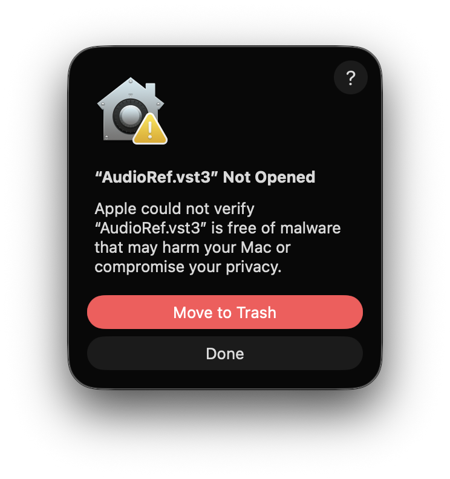
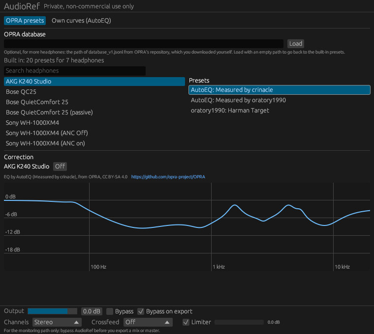
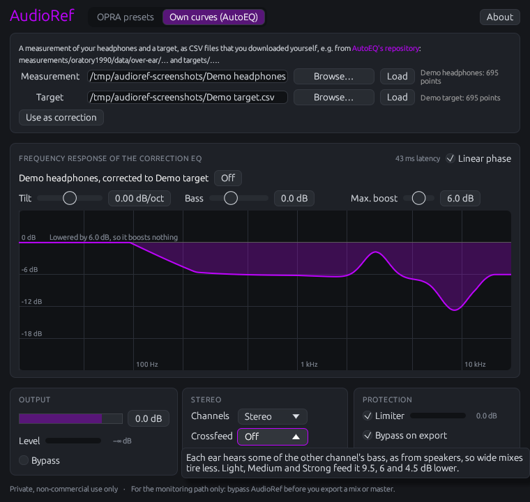
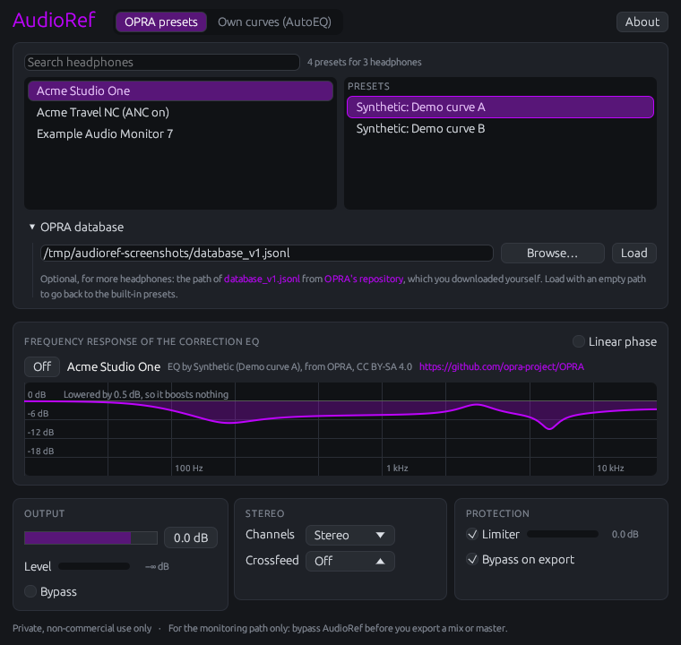
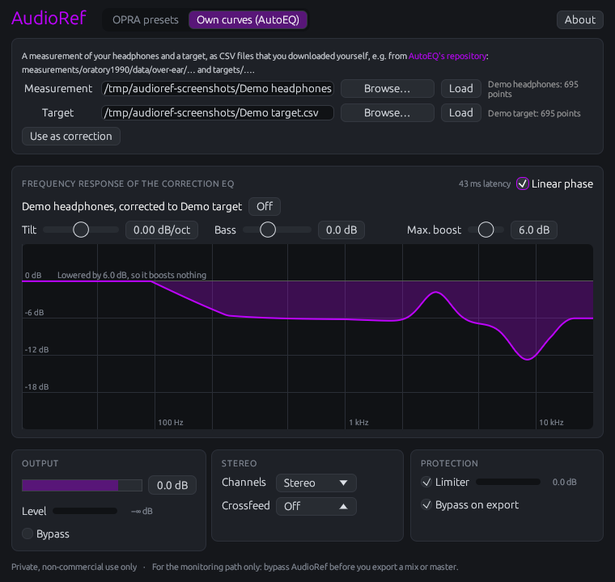

# AudioRef User Manual

## Introduction

### What AudioRef does

Every pair of headphones colors the sound: consumer headphones often lift the bass and some of the treble, studio headphones have their own peaks and dips. If you mix on them, you make up for their color without noticing, and the mix sounds wrong elsewhere. AudioRef corrects the frequency response of your headphones toward a neutral target, so they sound closer to studio monitors in a treated room.

It does that with an EQ made for your model of headphones:

- **EQ presets from OPRA**, the open database of headphone EQs. Presets for the Bose QC25, the Sony WH-1000XM4 and the AKG K240 Studio are built in, so these headphones work without a download. For all others, you load OPRA's database, which you download yourself.
- **Your own measurement and target**, as CSV files, e.g. from AutoEQ's repository: AudioRef computes the correction from them, and you adjust it to your taste.

Around the correction, AudioRef has what monitoring on headphones needs: automatic headroom, so the correction never makes anything louder, an optional linear-phase mode, mono and swapped channels, a crossfeed in three strengths, an output level with a meter, and a limiter that keeps the output from clipping. When your DAW exports a mix offline, AudioRef bypasses itself, so the correction of your headphones doesn't end up in the mix.

### What AudioRef doesn't do

AudioRef corrects the average frequency response of a model of headphones, as measured on a rig. It doesn't measure your own pair or your ears, and it doesn't simulate speakers in a room. Your headphones, their pads and how they sit on your head still differ a little from the measurement, most of all above 5 kHz. A corrected pair of headphones is a better reference, not a replacement for checking a mix on other systems.

### What you need

| | |
|--|--------|
| Systems | Windows 10 or newer (x86_64), macOS (Intel and Apple silicon), Linux (x86_64) |
| Plugin formats | VST3 and CLAP |
| DAWs | Any that loads VST3 or CLAP; tested in Bitwig Studio 6 (CLAP and VST3) and FL Studio on Windows |
| Sample rates | 44.1 to 192 kHz |
| Channels | Stereo in, stereo out |
| Latency | None, or 43 to 46 ms with linear phase |

### Terms of use

> [!IMPORTANT]
> **AudioRef is for private, non-commercial use only**, and comes without any warranty.
>
> The built-in presets are OPRA's, by oratory1990 and AutoEQ, under CC BY-SA 4.0. Everything else AudioRef reads from files you download yourself, from AutoEQ or OPRA. These data belong to their authors and have their own terms: oratory1990 prohibits unlicensed commercial use of his measurements. Don't use AudioRef or such data commercially without their authors' permission.

### About this manual

This manual describes everything you can do in the plugin's window and in your DAW, for the version on its title page. The manual is written in Markdown in [`docs/manual`](https://github.com/FionaPreroll/audioref/tree/main/docs/manual), in English and in German, and comes as a PDF in every download of AudioRef. The [README](https://github.com/FionaPreroll/audioref#readme) has a short version of it.

## Installing

### Downloading

Download the archive for your system from the [latest release](https://github.com/FionaPreroll/audioref/releases/latest) on GitHub, or from the pre-release [`snapshot`](https://github.com/FionaPreroll/audioref/releases/tag/snapshot), which always has the latest build:

| System | Archive |
|---|---|
| Windows 10 or newer, x86_64 | `audioref-windows-x86_64.zip` |
| macOS, Intel and Apple silicon | `audioref-macos-universal.zip` |
| Linux, x86_64 | `audioref-linux-x86_64.zip` |

Each archive holds the plugin as `AudioRef.vst3` and `AudioRef.clap`, this manual in English and German (`audioref-manual-en.pdf`, `audioref-manual-de.pdf`), the README, the changelog, the license, and the source and license of the built-in presets (`OPRA-PRESETS.md`). The release also offers the manuals as downloads of their own.

To check a download, compare its checksum with the file `SHA256SUMS` of the release, and verify with the [GitHub CLI](https://cli.github.com) that AudioRef's own workflow built it:

```sh
sha256sum --check --ignore-missing SHA256SUMS
gh attestation verify audioref-windows-x86_64.zip --repo FionaPreroll/audioref
```

### Copying the plugins

Unpack the archive and copy the bundles to the folders where your DAW looks for plugins:

| System | Copy `AudioRef.vst3` to | Copy `AudioRef.clap` to |
|---|---|---|
| Windows | `C:\Program Files\Common Files\VST3` | `C:\Program Files\Common Files\CLAP` |
| macOS | `~/Library/Audio/Plug-Ins/VST3` | `~/Library/Audio/Plug-Ins/CLAP` |
| Linux | `~/.vst3` | `~/.clap` |

You need only one of the two formats, the one your DAW prefers; copying both does no harm. Then let your DAW rescan its plugins. In Bitwig, use the CLAP version.

### macOS: allowing the plugins

On macOS, the bundles are signed ad hoc but not notarized by Apple, so macOS may refuse to load them the first time:



Click **Done**, not **Move to Trash**, and allow both bundles once in the Terminal:

```sh
xattr -dr com.apple.quarantine \
    ~/Library/Audio/Plug-Ins/VST3/AudioRef.vst3 \
    ~/Library/Audio/Plug-Ins/CLAP/AudioRef.clap
```

Then let your DAW rescan its plugins again.

### Updating and removing

To update AudioRef, replace the bundles with those of the new version, with your DAW closed. Projects keep their settings: they open with the same correction in the new version.

To remove AudioRef, delete `AudioRef.vst3` and `AudioRef.clap` from the folders above. AudioRef writes no other files: everything it remembers is saved in your projects.

## Quick start

1. Put AudioRef on your master track, as the last plugin, after everything else.
2. Open AudioRef's window. It lists the headphones with built-in presets.
3. Click your headphones, e.g. "Sony WH-1000XM4". If they come in several modes, e.g. "(ANC on)" and "(ANC Off)", pick the one you listen in.
4. Click a preset on the right. Presets by oratory1990, or "Measured by oratory1990", are a good start.
5. Listen. **Bypass** switches the correction off and on, to compare.
6. Before you export a mix, nothing needs doing in most DAWs: AudioRef bypasses itself while the DAW exports offline. If your DAW exports in real time, bypass AudioRef yourself, see [Exporting](#exporting).



The project saves the chosen preset, so it opens with the same correction, even on a computer without any files. If your headphones aren't built in, see [More headphones from OPRA's database](#more-headphones-from-opras-database).

## The window

AudioRef's window has the same parts in all its uses, from top to bottom:

| Part | What it holds |
|----|----------------|
| Top bar | The name AudioRef, the tabs **OPRA presets** and **Own curves (AutoEQ)**, which choose where the correction comes from, and **About** |
| Source | In **OPRA presets**: the search, the list of headphones, their presets, and the section **OPRA database** that folds away. In **Own curves (AutoEQ)**: the files of a measurement and a target, and **Use as correction** |
| Correction | **Frequency response of the correction EQ**: the switch **Linear phase**, the name of the current correction with its author, **Off**, for your own curves the sliders **Tilt**, **Bass** and **Max. boost**, and the curve |
| Output | The output level, the meter **Level** and **Bypass** |
| Stereo | **Channels** and **Crossfeed** |
| Protection | **Limiter** with its meter, and **Bypass on export** |
| Notices | "Private, non-commercial use only", and that AudioRef belongs in the monitoring path only |

The curve shows the correction from 20 Hz to 20 kHz, with a line every 6 dB. Rest the pointer on it to read the level at a frequency, e.g. "1.2 kHz −4.3 dB". Above the line of 0 dB, it says by how much AudioRef lowered the correction, see [Headroom](#headroom).

### Hints

Rest the pointer on any control to see what it does. Where the window waits for something, it says what to do next: to pick headphones, to load both curves before using them, or to lower the output level when the limiter has much to do.



### Language

The window and the parameter names follow the language of your operating system: German on German systems, English on all others. A project saved in one language opens in the other with the same settings, as DAWs save parameters by their IDs, not by their names.

### About

**About** at the top right, or a click on the name AudioRef, opens the about window: the version and the build of AudioRef, how to reach its author, its homepage, a link to every version to download, the licenses of AudioRef and of its built-in presets, and every piece of software AudioRef is built with, with its license text.

Two of its lines help when something doesn't work as expected, e.g. to say which AudioRef you run when you report a problem:

- **Format** says which of the two plugins the DAW loaded: **CLAP** or **VST3**. A DAW that offers both lists AudioRef twice; each window shows which one it is.
- **Built by GitHub** says whether the plugin comes from GitHub Actions, which builds the archives of the [releases](https://github.com/FionaPreroll/audioref/releases), with a link to that run, or was built elsewhere, e.g. from the source on your own computer.

## Correcting with OPRA's presets

[OPRA](https://github.com/opra-project/OPRA) is an open, community-maintained database of EQ presets for headphones. oratory1990 publishes his presets there himself, and AutoEQ adds presets computed from the measurements of several reviewers. A preset is a parametric EQ: a list of filters, e.g. peaks, dips and shelves, with their frequencies, gains and widths, and an overall gain. AudioRef runs it with filters that follow the preset closely up to the highest frequencies, at every sample rate.

### Built-in headphones

Without any file, the list holds the headphones whose presets are built into AudioRef, from OPRA's database of 8 November 2026:

| Headphones | In the list |
|---|---|
| AKG K240 Studio | K240 Studio |
| Bose QC25 | QC25, QuietComfort 25, QuietComfort 25 (passive) |
| Sony WH-1000XM4 | WH-1000XM4, WH-1000XM4 (ANC on), WH-1000XM4 (ANC Off) |

Beside the search, the window says how many presets the list holds, e.g. "Built in: 20 presets for 7 headphones". OPRA lists some modes of a model as headphones of their own, e.g. with active noise cancelling on or off, and some under the model's other names, e.g. QC25 and QuietComfort 25: their presets are by different authors.

### More headphones from OPRA's database

For other headphones, download OPRA's whole database and let AudioRef read it:

1. Download the file [`dist/database_v1.jsonl`](https://github.com/opra-project/OPRA/tree/main/dist) from OPRA's repository, about 12 MB, and keep it anywhere, e.g. in your documents. The note under the field in **OPRA database** links the file too: click `database_v1.jsonl` there to download it in your browser, or **OPRA's repository** to see where it comes from.
2. In AudioRef's window, open **OPRA database** below the lists.
3. Click **Browse…** beside the field and pick the file in your system's file dialog. Or paste the file's path into the field, e.g. `C:\Users\you\Documents\database_v1.jsonl` or `/Users/you/Documents/database_v1.jsonl`, and click **Load**.

The dialog opens in the folder of the file in the field, if there is one, and lists OPRA's `.jsonl` files; choose "All files" in it for others. AudioRef loads the file you pick at once. On macOS the dialog stays in front of the DAW until you close it; on Windows and Linux the DAW goes on, and while the dialog is open, AudioRef opens no other. On Linux, the dialog comes from the XDG desktop portal of your desktop, or from zenity without one; if neither is installed, no dialog opens: paste the path instead.

AudioRef reads the file in the background, in about a tenth of a second, and then says how many presets it found, as "… presets for … headphones". It remembers the path in the project and loads the file again the next time it opens. **Load** with an empty field goes back to the built-in presets.



If AudioRef can't use the file, it says why and keeps the presets it had: "This file isn't OPRA's database." or "The file couldn't be read:" with the reason of your system, e.g. that the file doesn't exist. A newer OPRA may add lines that AudioRef doesn't understand yet; it leaves them out and says how many, e.g. "3 lines left out, which AudioRef doesn't understand", and uses all the others.

> [!TIP]
> If you build AudioRef from source, `cargo xtask fetch-profiles` downloads the database for you, see [Fetching the files](#fetching-the-files).

### Finding your headphones

Type part of the name into **Search headphones**, e.g. "WH-1000XM4" or "HD 6". The search finds the headphones whose name, with the vendor's, holds every word you type, in any case, e.g. "sony 1000xm4", and lists the first 200 by name. Headphones with several modes are listed once for each, e.g. "(ANC on)", "(ANC off)" or "(passive)": pick the one you listen in. If nothing fits, the list says "No headphones match."

### Choosing a preset

Click your headphones, then a preset on the right: it becomes the correction at once, faded over 20 ms so it doesn't click. Most headphones have several presets:

- **oratory1990**, e.g. "oratory1990: Harman Target": made by oratory1990 from his own measurements, toward the Harman target. A good first choice.
- **AutoEQ**, e.g. "AutoEQ: Measured by oratory1990": computed by AutoEQ from the measurement named, toward its target. oratory1990 measures on the kind of rig the Harman target was defined on.
- Others, by other authors, as named.

Try two or three and keep the one that sounds most natural to you, e.g. on a well-known reference track. Below the curve's heading, the window shows the headphones and who made the preset, e.g. "EQ by AutoEQ (Measured by crinacle), from OPRA, CC BY-SA 4.0", with a link to OPRA's repository, as OPRA's license asks.

### Headroom

An EQ that corrects headphones lifts some frequencies, e.g. a dip in the treble. Lifting them would make the signal louder and could clip. So AudioRef lowers the whole correction by its largest boost, between 20 Hz and 20 kHz: the corrected signal is never louder than the input at any frequency. The window says by how much, e.g. "Lowered by 6.0 dB, so it boosts nothing", and the curve stays at or below 0 dB.

Most presets bring headroom of their own, so AudioRef needs to lower them little or not at all. If the corrected sound is quieter than you like, raise **Output**: the limiter catches the peaks, see [Limiter](#limiter).

### Turning the correction off

**Off**, beside the name of the correction, turns the correction off: the signal passes unchanged, apart from the stereo settings and the output level. The window then says "No correction: the signal passes unchanged." To compare with and without everything, use **Bypass** instead.

### What the project saves

The project saves the chosen preset itself, with all its filters, not only its name. It opens with the same correction on a computer without OPRA's file, and the window shows its headphones and the preset selected. The path of OPRA's database is saved too.

## Your own measurement and target

Instead of a preset, AudioRef can compute the correction from two curves: a measurement of your model of headphones, and the target you want them to sound like. That is how AutoEQ makes its presets, but here you choose the files and adjust the result while you listen.

### The files

Both curves are CSV files with a column of frequencies in Hz and one of levels in dB, as in [AutoEQ's repository](https://github.com/jaakkopasanen/AutoEq):

- Measurements, e.g. `measurements/oratory1990/data/over-ear/AKG K240 Studio.csv`.
- Targets, e.g. `targets/Harman over-ear 2018.csv`.

Download them yourself: AudioRef ships no measurements. The note at the top of the tab **Own curves (AutoEQ)** links AutoEQ's repository: click **AutoEQ's repository** to open it in your browser. They are for your private, non-commercial use only, see [Terms of use](#terms-of-use).

AudioRef reads AutoEQ's format, a header `frequency,raw` and a line per frequency, and what other tools write: more columns (it takes the column `raw`, or else the one after the frequency), no header, semicolons with decimal commas, tabs or spaces, and comments starting with `#` or `*`. A curve needs at least 2 points and at most 100,000, with rising frequencies, and must reach from 100 Hz to 10 kHz. Between its points, AudioRef draws straight lines on a logarithmic frequency axis; beyond its ends, it stays flat.

> [!NOTE]
> Measurement and target should come from the same kind of rig. The Harman target was defined on a GRAS rig, which oratory1990 uses, so his measurements and AutoEQ's Harman targets fit together. Mixing rigs shifts the treble.

### Loading the curves

1. Open the tab **Own curves (AutoEQ)**.
2. Click **Browse…** beside **Measurement** and pick the measurement's file. Or paste its path into the field and click **Load** beside it.
3. Do the same for the target, beside **Target**.

The dialog lists CSV and text files (`.csv`, `.txt`, `.tsv`), and opens in the folder of the file in the field, if there is one. AudioRef loads the file you pick at once.

Beside each, AudioRef shows the curve's name and how many points it read, e.g. "AKG K240 Studio: 695 points", or why it can't use the file:

| Message | What to do |
|--------|-------|
| This file isn't a curve: it has no lines with a frequency and a level. | Check that you chose the CSV file, not e.g. a web page saved as `.csv`. |
| The curve only reaches from … to … Hz, but needs 100 to 10,000 Hz. | Use a curve that covers at least 100 Hz to 10 kHz. |
| This file has more than 100,000 points. | Use a curve with fewer points. |
| The file couldn't be read: … | Check the path; the reason comes from your system. |

### Using them as the correction

Click **Use as correction**. It is only available once both curves are loaded; until then, its hint says "Load a measurement and a target first." AudioRef then computes the correction, in a few milliseconds:

1. The difference of target and measurement, with your tilt and bass added, see below.
2. Smoothed over 1/12 octave up to 2 kHz, wider above and over 1/3 octave from 8 kHz, so the narrow peaks and dips of one measurement, which move with every fit on the head, aren't copied.
3. Set to 0 dB on average from 200 Hz to 2 kHz.
4. Faded out from 12 to 16 kHz, with no correction above: up there, the sound depends more on your ears and the fit than on the headphones.
5. Boosts limited to **Max. boost**, cuts to −30 dB.
6. Lowered by its largest boost, so it makes nothing louder, as for presets, see [Headroom](#headroom).

The correction is named after both curves, e.g. "AKG K240 Studio, corrected to Harman over-ear 2018", and replaces any preset. Choosing a preset again replaces it in turn.



### Adjusting the correction

Three sliders above the curve adjust the correction to your taste. The curve follows a slider at once; the sound follows when you let go of it.

| Slider | Range | Default | What it does |
|---|----|---|----------|
| **Tilt** | −1 to +1 dB/oct | 0 dB/oct | Tilts the sound around 1 kHz: below 0 darker, above 0 brighter. 0.5 dB per octave is already clearly audible. |
| **Bass** | −6 to +12 dB | 0 dB | Raises or lowers the bass below about 100 Hz, with the shelf of the Harman target: half its gain at 105 Hz. |
| **Max. boost** | 0 to 12 dB | 6 dB | How much the correction may lift frequencies your headphones lack. More boost lowers the whole level more, and may sound strained. |

### What the project saves

The project saves both curves, their names and the settings of the sliders, so it opens with the same correction without the files. The paths of the files are saved too.

### Fetching the files

If you build AudioRef from its source, `cargo xtask fetch-profiles` downloads the files for both tabs at once, into the folder `AudioRef profiles` in your home folder: OPRA's `database_v1.jsonl`, AutoEQ's target `targets/Harman over-ear 2018.csv`, and oratory1990's measurements of the AKG K240 Studio, the Bose QuietComfort 25 and the Sony WH-1000XM4 in `measurements/`. Name other headphones as AutoEQ does, or a part of the name, and another folder with `--to`:

```sh
cargo xtask fetch-profiles --to ~/Music/headphones "HD 600" "WH-1000XM4"
```

It needs curl, which Windows 10 and later, macOS and most Linux systems have. It checks that AudioRef can read each file, and names the rig each measurement was made on. It refuses a folder inside AudioRef's repository, which never holds headphone data. The measurements are for your private, non-commercial use only, see [Terms of use](#terms-of-use).

## Linear phase

**Linear phase**, at the top right of the frequency response, decides how AudioRef runs the correction, a preset or your own curves. The level at each frequency, and so the curve, is the same either way.

### Minimum phase and linear phase

Off, the default, AudioRef corrects like an analog EQ: without latency, and with small shifts of the phase where the level changes. That is what nearly every EQ in a mix does, and you won't hear it on a correction.

On, the correction doesn't shift the phase at all, so transients keep their exact shape. In exchange, it delays the sound by about 45 ms. The window shows by how much, e.g. "43 ms latency".

### Latency

| Sample rate | Latency |
|---|---|
| 44.1, 88.2 and 176.4 kHz | 46 ms |
| 48, 96 and 192 kHz | 43 ms |

AudioRef tells your DAW its latency, and the DAW makes up for it in playback, so the tracks stay in time with each other and with the picture. What the DAW can't make up for is live input: while you record or play an instrument through the DAW, you hear yourself 43 to 46 ms late, which is too much to play to.

> [!TIP]
> Leave **Linear phase** off while you record, and turn it on for mixing and mastering if you like. The project saves the choice.

Linear phase costs as much processing as the minimum-phase correction of your own curves, see [Specifications](#specifications).

## Output, stereo and protection

The three cards at the bottom of the window hold the parameters, which your DAW shows and can automate too, see [Parameters](#parameters). Changes of every parameter fade over 20 ms, so they don't click.

### Output

**Output** sets the level after the correction, from −24 to +6 dB, 0 dB by default. Raise it to make up for the headroom of a correction; the limiter keeps the peaks below clipping.

**Level** shows the peak level of AudioRef's output, from −60 to 0 dBFS, as a bar and in dB. It moves whenever sound plays. With the limiter on, it stays at or below −0.3 dBFS.

**Bypass** passes the signal through unchanged, around everything in AudioRef: correction, stereo settings, output level and limiter. Use it to compare.

### Channels

| Setting | What you hear |
|---|---------|
| **Stereo** | The channels as they are (default) |
| **Mono** | Both channels in both ears, each at half the level, to check how a mix sounds in mono |
| **Swapped** | The left channel on the right and the other way round, e.g. to check which side of your headphones is which |

### Crossfeed

On headphones, each ear hears only its own channel, while from speakers each ear hears both, the other one a little later and with less treble. So wide mixes sound wider on headphones than on speakers, and tire more. **Crossfeed** lets each ear hear some of the other channel's bass, as from speakers. What both channels share, e.g. vocals in the middle, stays as it is.

| Setting | The other channel's bass, below the own channel | Like |
|---|---|---|
| **Off** | – (default) | |
| **Light** | 9.5 dB | Jan Meier's crossfeed |
| **Medium** | 6 dB | Chu Moy's crossfeed |
| **Strong** | 4.5 dB | bs2b's default |

Above about 700 Hz, the crossfeed gets weaker and weaker. Try **Light** first: crossfeed changes how wide a mix seems, so switch it off now and then to check the stereo image as listeners on headphones hear it.

### Limiter

**Limiter**, on by default, keeps the output at or below −0.3 dBFS, both channels together, without latency. The bar beside it shows by how much it lowers the signal, from 0 to 12 dB. It moves only when the level would go above, so it often stays empty. A little now and then is fine; if it lowers the signal by 3 dB or more, the window says "Lower the output level": the limiter would then change the sound you judge your mix by.

The limiter only protects your ears and your headphones from overs that AudioRef itself would cause, e.g. by a raised output level. It doesn't change your mix, as it is part of the monitoring path.

### Bypass on export

**Bypass on export**, on by default, bypasses AudioRef while your DAW exports offline, faster than real time, so the correction of your headphones doesn't end up in your mix. It is saved with the project but can't be automated. Leave it on, see [Exporting](#exporting).

### Turning the meters off

The meters make the window draw itself 30 times a second. On slow graphics, click either bar, **Level** or the limiter's, to cross both out: the window is then drawn again only when something in it changes. Click again to turn them back on. The project saves the choice; the limiter works either way.

## AudioRef in your DAW

### Where it goes

AudioRef corrects your headphones, not your mix, so it belongs in the monitoring path: last on the master track, after everything else, including any limiter of your master. Neither Bitwig nor FL Studio has a separate monitoring path for plugins, so the master track is the place.

Don't put AudioRef on single tracks or buses: it would correct them for your headphones only.

To find it in your DAW's plugin browser: AudioRef calls itself a mastering effect, in the VST3 and the CLAP version alike, so DAWs that sort plugins by category list it under **Mastering**, some also under **EQ**.

### Exporting

What you export must not contain the correction. AudioRef takes care of that where it can:

| Your DAW exports | AudioRef | What you do |
|-----|-----|-----|
| Offline, faster than real time (most DAWs, e.g. Bitwig and FL Studio by default) | Bypasses itself, from the first sample, with **Bypass on export** on | Nothing |
| In real time, e.g. recording the output | Can't tell an export from playback | Turn **Bypass** on before you export, and off afterwards |

> [!WARNING]
> If you turn **Bypass on export** off, or your DAW exports in real time, the exported file has the correction of your headphones in it. The notice at the bottom of the window reminds you: "For the monitoring path only: bypass AudioRef before you export a mix or master."

### Bitwig Studio

Use the CLAP version. Put AudioRef last in the device chain of the master track. Bitwig exports offline, and AudioRef bypasses itself while it does, in the CLAP and the VST3 version alike (tested with Bitwig Studio 6).

### FL Studio

Put AudioRef in the last slot of the master track in the mixer. FL Studio's export is offline by default, and AudioRef bypasses itself while it runs (tested on Windows).

### Automation

All parameters except **Bypass on export** can be automated, e.g. to switch **Channels** to mono for a passage. The names follow the language of your system, see [Language](#language). DAWs save parameters by IDs that never change, so a project opens with the same settings in every version of AudioRef and in either language. The settings of the window that aren't parameters, e.g. the preset or **Linear phase**, are saved with the project but can't be automated, see [Saved with the project](#saved-with-the-project).

### Latency compensation

Without **Linear phase**, AudioRef has no latency. With it, AudioRef reports its latency to the DAW, which delays everything else to match. When you turn **Linear phase** on or off, AudioRef tells the DAW the new latency at once.

## Reference

### Parameters

| Name | German name | Range | Default | Automatable |
|----|----|------|---|---|
| Output | Ausgang | −24 to +6 dB, in steps of 0.1 dB | 0 dB | Yes |
| Bypass | Umgehen | On, off | Off | Yes |
| Bypass on export | Beim Export umgehen | On, off | On | No |
| Channels | Kanäle | Stereo, Mono, Swapped (Vertauscht) | Stereo | Yes |
| Crossfeed | Crossfeed | Off, Light, Medium, Strong (Aus, Leicht, Mittel, Stark) | Off | Yes |
| Limiter | Limiter | On, off | On | Yes |

In a DAW's field for a value, you can type the name of a setting in either language, in any case, e.g. "mono" or "vertauscht", or its number, counted from 0.

### Saved with the project

Besides the parameters, the project saves:

| Setting | Saved |
|---|---------|
| The correction | The chosen preset with all its filters, or both curves of your own with tilt, bass and max. boost, so it opens without any files |
| Paths | The paths of OPRA's database, the measurement and the target |
| **Linear phase** | On or off |
| Meters | Shown or crossed out |
| The window | Its size |

### Messages

| Message | Meaning |
|-------|------|
| Built in: 20 presets for 7 headphones | No database is loaded: the list holds the built-in presets. |
| … presets for … headphones | OPRA's database is loaded, with as many presets. |
| … lines left out, which AudioRef doesn't understand | Lines of the database that a newer OPRA added, or with values outside what AudioRef allows. The others work. |
| This file isn't OPRA's database. | The file at the path has no lines of OPRA's format. |
| No headphones match. | The search found nothing: try a shorter part of the name. |
| Pick your headphones on the left, then one of their presets. | No correction is chosen yet. |
| No correction: the signal passes unchanged. | **Off** was clicked, or nothing is chosen. |
| Lowered by … dB, so it boosts nothing | The headroom AudioRef gave the correction, see [Headroom](#headroom). |
| … ms latency | **Linear phase** is on, with this latency. |
| Lower the output level | The limiter lowers the signal by 3 dB or more. |

### Specifications

| | |
|--|---------|
| Presets | Up to 32 filters each (peaks, low and high shelves, low and high passes), computed with 64 bits, matched to the analog filters up to half the sample rate |
| Own curves | A minimum-phase FIR filter of 4096 taps at 44.1 and 48 kHz, 8192 at 88.2 and 96 kHz and 16384 at 176.4 and 192 kHz, without latency |
| Linear phase | A linear-phase FIR filter of as many taps, with a latency of half of them, see [Latency](#latency) |
| Headroom | The correction lowered by its largest boost from 20 Hz to 20 kHz |
| Crossfeed | Bauer's crossfeed in a form that leaves the middle unchanged: a first-order low pass at 700 Hz, 9.5, 6 or 4.5 dB |
| Limiter | Ceiling −0.3 dBFS, both channels linked, no lookahead and no latency, release 100 ms |
| Fades | 20 ms for every parameter and every change of the correction |
| Processing | On one core, about 1 % at 48 kHz, 2 % at 96 kHz and 6 % at 192 kHz, for the FIR filters of both channels |

## Troubleshooting

**My DAW doesn't list AudioRef.**
Check that the bundles are in the folders of [Copying the plugins](#copying-the-plugins), and let the DAW rescan its plugins. On macOS, allow them first, see [macOS: allowing the plugins](#macos-allowing-the-plugins). On Windows, the folders under `C:\Program Files` need administrator rights to copy into.

**My headphones aren't in the list.**
Only three models are built in. Load OPRA's database, see [More headphones from OPRA's database](#more-headphones-from-opras-database), and search for them. If OPRA has no preset for them either, use a measurement from AutoEQ and a target, see [Your own measurement and target](#your-own-measurement-and-target).

**Browse… opens no dialog on Linux.**
AudioRef asks your desktop for the dialog through the XDG desktop portal, or else zenity. Install your desktop's portal, e.g. `xdg-desktop-portal-gtk` or `xdg-desktop-portal-kde`, or zenity, or paste the path into the field and click **Load**.

**The corrected sound is quieter.**
That is the headroom, which keeps the correction from clipping. Raise **Output** by as much as the window says the correction was lowered.

**The limiter's bar moves a lot, or the window says "Lower the output level".**
The output level is too high for the material. Lower **Output** until the limiter lowers the signal only now and then.

**I hear my instrument late while recording.**
**Linear phase** is on. Turn it off while you record, see [Latency](#latency).

**The window is slow, or the DAW stutters while it is open.**
Click either meter to cross both out, see [Turning the meters off](#turning-the-meters-off).

**My exported mix sounds like it has the headphone correction in it.**
Your DAW probably exported in real time, or **Bypass on export** is off. Turn on **Bypass** before exporting, see [Exporting](#exporting).

**The window shows English on a German system, or the other way round.**
AudioRef follows the language your operating system reports to programs, not that of your DAW. Change the language of the system, or of your user account, and restart the DAW.

## Licenses and credits

AudioRef is free software, licensed under the [GNU General Public License v3.0 only](https://github.com/FionaPreroll/audioref/blob/main/LICENSE). Its VST3 support uses nih-plug's VST3 bindings, which are licensed under the GPLv3 as well. The source is on [GitHub](https://github.com/FionaPreroll/audioref).

The built-in EQ presets are an excerpt of [OPRA](https://github.com/opra-project/OPRA)'s database, by oratory1990 and AutoEQ (Jaakko Pasanen), computed from measurements by oratory1990, crinacle, Innerfidelity, Rtings and HypetheSonics. They are licensed under [CC BY-SA 4.0](https://creativecommons.org/licenses/by-sa/4.0/), not under AudioRef's license; the archives hold their source and authors as `OPRA-PRESETS.md`.

The window uses the fonts that come with egui: Ubuntu Light under the [Ubuntu Font Licence 1.0](https://ubuntu.com/legal/font-licence), and Noto Emoji and emoji-icon-font under the [SIL Open Font License 1.1](https://openfontlicense.org). The about window lists every other piece of software AudioRef is built with, with its license text.

This manual is set in Latin Modern with LaTeX.
